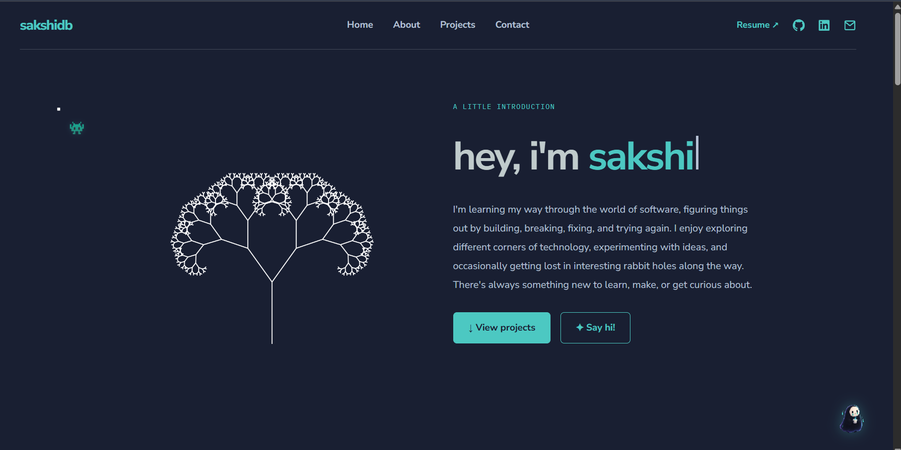

# ✦ sakshidb - Personal website

A personal portfolio website built to showcase my projects, technical interests, and work. Designed with a focus on simplicity, creativity, and interactive details.

## 📸 Preview



---

### 🛠️ Tech Stack

- **Frontend:** Astro, HTML, CSS, JavaScript
- **Backend:** Astro API Routes
- **Database:** Supabase
- **Deployment:** Vercel
- **Design & Icons:** Custom CSS keyframe animations, SVG iconography, pixel-art companion motif

 ---

### 🚀 Local Development

1. **Clone the repository:**
   ```bash
   git clone https://github.com/sakshi-db/sakshidb-website.git
   cd sakshidb-website
   ```

2. **Install dependencies:**
   ```bash
   npm install
   ```

3. **Configure Environment Variables:**
   Create a `.env` file in the root directory and add your Supabase credentials:
   ```env
   PUBLIC_SUPABASE_URL=your_supabase_project_url
   PUBLIC_SUPABASE_ANON_KEY=your_supabase_anon_key
   ```

4. **Run local dev server:**
   ```bash
   npm run dev
   ```

---

### 🌐 Live Website

[Visit Website](https://sakshidb.vercel.app/)

*Built with curiosity and a little creativity.*


> **P.S.** This site is equal parts portfolio and personal sandbox. While I wanted it to stay clean and functional, I also couldn't resist sneaking in a few cute characters (like the site keeper 👻) and experimental widgets. Think of it less as a stiff corporate resume and more as a cozy corner of the internet where I test out ideas. Hope you enjoy poking around!